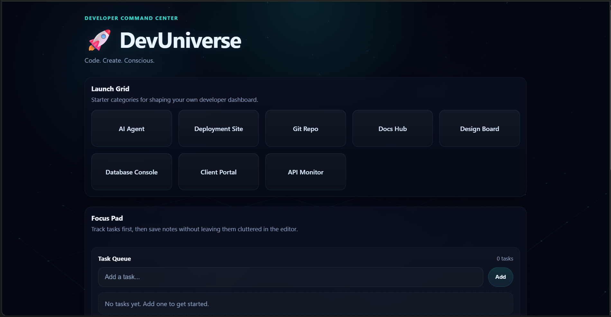

# DevUniverse V1

A personal developer dashboard built with HTML, CSS, and vanilla JavaScript. It brings a task list and notes workspace together in a dark, space-inspired interface.

This repository contains the original public project. DevUniverse Portal is a separate, private project that builds on the dashboard concept.

## Preview



## What it does

- Add tasks, mark them complete, and delete them.
- Write notes with an optional title. Drafts save automatically as you type.
- Save notes to a collapsible list with previews and timestamps.
- Reopen saved notes to edit them, or delete notes you no longer need.
- Adapt the layout for smaller screens.

Tasks, saved notes, and the current draft are stored in the browser using `localStorage`. There are no accounts or cross-device sync. Clearing the browser's stored site data removes those records.

The Launch Grid contains eight starter categories, including a Git repo, docs hub, and deployment site. In this version, they are display tiles, not connected services or working links.

## Run locally

Clone the repository:

```bash
git clone https://github.com/OutsideofemiT/DevUniverse.git
cd DevUniverse
```

Open `DevUniverseV1/Dev_Universe.html` in your browser. There is no package installation or build step.

For a local-server workflow, serve the `DevUniverseV1` folder with your preferred static server and open `Dev_Universe.html` through it.

## Project structure

```text
README.md
DevUniverseV1/
  Dev_Universe.html
  README.md
  style.css
  addons/
  assets/
    DevUniverseV1.png
    Skygrid.png
```

The current page defines its styles and application logic directly in `Dev_Universe.html`. That is the starting point for changing the layout, task and note behavior, or launch tiles. The page uses `assets/Skygrid.png` as its background.

## Built by

Carmen Wheeler / Kairo Collective Studio
